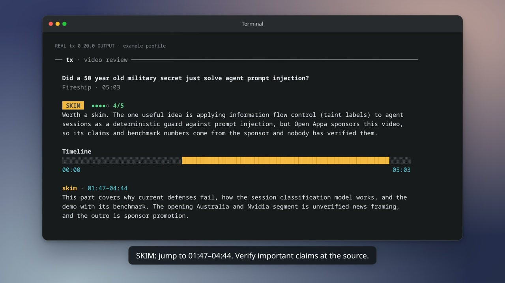

# tx

**Turn videos and podcasts into knowledge you keep.**

tx helps you decide **what is worth watching for you**, not just get a shorter version of a video. Give it a link, compare several videos, or have it screen new uploads from channels and podcasts you follow.

- **Review a link:** get a WATCH / SKIM / SKIP verdict, a relevance score, the part worth watching, and timestamped takeaways.
- **Choose what to follow:** get a YouTube channel report based on videos selected for your interests.
- **Keep up without checking every channel:** get a daily brief of new uploads, scored against your profile.
- **Keep what you learn:** ask your own question and save the answer as a Markdown note.

Open source, MIT licensed. Runs locally on macOS, Linux, and Windows. No tx account or hosted tx service; AI analysis uses your installed agent and its account.

**Start small:** review one video first. If the result is useful, add a profile. Follow a few sources and enable a schedule only if you want an ongoing brief.

## Watch the tutorial

[](https://github.com/jrydel/tx/releases/download/v0.20.0/tx-tutorial.mp4)

**[Watch or download the tutorial (MP4, 99 seconds, 5.7 MiB)](https://github.com/jrydel/tx/releases/download/v0.20.0/tx-tutorial.mp4)** — silent, with on-screen instructions. Uses real tx 0.20.0 review results with an example profile; typing is recreated and waits are shortened. Setup and scheduling scenes show commands to run, not a timer being enabled.

Chapters: **0:00** install · **0:07** add context · **0:21** review one video · **0:44** review several · **0:59** evaluate a channel · **1:13** follow sources · **1:19** screen new uploads · **1:25** optional daily schedule.

## Quick start

For analysis, first install and sign in to **[Codex CLI](https://learn.chatgpt.com/docs/codex/cli)** (`codex`) or **[Claude Code](https://code.claude.com/docs/en/quickstart)** (`claude`). You only need one. Fetching a transcript without AI does not require either.

### 1. Install

**macOS (Apple Silicon) or Linux (x86_64):**

```sh
curl -fsSL https://raw.githubusercontent.com/jrydel/tx/master/install.sh | sh
```

**Windows (x64), in PowerShell:**

```powershell
irm https://raw.githubusercontent.com/jrydel/tx/master/install.ps1 | iex
```

When run in a terminal, the installer starts guided setup: connect your AI apps, describe your interests or learn them from coding-agent sessions, choose what to follow, and optionally enable a daily brief. **For a one-off video review, skip setup with Ctrl+C.** Run `tx onboard` later to return to it. An already-configured installation shows your status instead.

If the installer added tx to your PATH, open a new terminal before running commands. Check the installation:

```sh
tx --version
```

No plugin, daily schedule, or environment variable is required for terminal reviews. To prevent the installer from opening setup, set `TX_NO_SETUP=1` before installing.

### 2. Try a video

Copy this example, then replace the quoted URL with your own:

```sh
tx "https://www.youtube.com/watch?v=USeyDcWyVCc" -q
```

`-q` asks: **“Is this video worth watching? Which parts should I watch, and why?”** It automatically selects an installed agent: Claude first, then Codex, unless you have configured an environment override.

Prefer Codex explicitly?

```sh
tx "https://www.youtube.com/watch?v=USeyDcWyVCc" -g codex -q
```

Or ask a question relevant to you:

```sh
tx "https://www.youtube.com/watch?v=USeyDcWyVCc" -g codex -q "As a software engineer, what matters here?"
```

The result includes a 0–5 relevance score, a WATCH / SKIM / SKIP verdict, timestamped takeaways, and a TL;DR. A timeline is shown when the source provides a duration. This is a text view, not an embedded video player. Once tx has learned who you are (`tx learn`), the review is written for you: takeaways name the projects a moment matters for.

The score measures relevance to you, not the video's objective quality. Start with the verdict: **WATCH** means watch it, **SKIM** points you to the useful range, and **SKIP** means it is a low priority for this profile. Check important claims against the linked source.

**Click to watch:** in a terminal that supports OSC 8 hyperlinks, Ctrl+click a takeaway timestamp, either end of the recommended watch range, or a position on the timeline to open that moment in your browser. In iTerm2 on macOS, use Cmd+click. The links remain usable after tx exits.

Timestamp links use known URL conventions for YouTube, Vimeo, Twitch VODs, Dailymotion, and direct media files. Playback still depends on the source being accessible and its player honoring the offset. Other sites keep a clickable source URL without pretending to support seeking.

### 3. Save takeaways to your own notes

Use `-a` for a free-form answer and `>` to save it:

```sh
tx "https://www.youtube.com/watch?v=USeyDcWyVCc" -g codex -a "3 timestamped takeaways as Markdown. Separate claims from evidence. Include the source URL." > video-notes.md
```

Open the file:

```sh
cat video-notes.md
```

The note is saved in your terminal's current folder. `>` replaces an existing file with that name, so choose a new filename for each video you want to keep. The commands above also work in PowerShell.

Review the generated note before moving it into your knowledge base. **tx does not automatically add it to a memory system.** A single-link review also does not follow the channel or add an analysis to your daily brief.

## Recommended workflow

### Once: give tx enough context to judge relevance

Without a profile, tx judges videos for a curious technical generalist. For personal recommendations, use either:

- **Your own description:** run `tx onboard` and describe your role, current work, what you want to learn, and what to skip. You do not need coding-agent history.
- **Learn from your work:** run `tx learn`. It uses your own prompts from Claude Code, Codex and Oh My Pi; you approve sending the excerpts and saving the profile. See [what is read and sent](#learn-who-you-are) first.

For example: “I'm a backend engineer building an LLM product. Prioritize agent evaluation, security and deployment. Skip beginner Python and product-launch hype.”

Check a learned profile with `tx learn --show`. Correct your own description through `tx onboard`; it takes precedence over the learned profile. Profiles are used by `-q` reviews, channel reports and followed-source screening. **For `-a` questions and `-c` chats, include relevant personal context in your question or conversation yourself.**

### When you find something: choose the right command

| Situation | Use | What happens to the result |
| --- | --- | --- |
| Someone sends you a video | `tx "URL" -q` | Prints a review; does not follow its channel or add it to your brief |
| You have several tabs to triage | `tx "URL1" "URL2" "URL3" -q` | Reviews concurrently, then prints each review in input order |
| You are deciding whether to follow a YouTube channel | `tx channel @t3dotgg --top 5` | Prints and saves a channel report; does not follow the channel |
| You want a reusable note | `tx "URL" -a "Explain the technique with timestamps and the source URL" > note.md` | Saves the answer in your current folder; overwrites that filename if it exists |
| You want new uploads from sources you already follow | `tx run` | Screens pending uploads and saves results for the brief and digest |

Replace `URL`, `URL1`, etc. with actual links. Use the channel report to decide what to follow, not to transcribe an entire archive. Start with `--top 5`; increase it if you want a broader sample.

### Ongoing: follow a few sources, then decide whether to automate

1. Run `tx onboard` to choose YouTube channels or podcasts. You can decline scheduling and accept the offered first screening to try the brief.
2. Run `tx run` whenever you want to check for new uploads. It shows progress in your terminal and prints the digest path when one is written.
3. In a connected AI app, ask **“Show me my tx brief.”** Start with Watch and Skim; use the timestamps instead of watching everything.
4. If the brief is useful, run `tx schedule --at 08:00`. Stop future scheduled runs with `tx schedule --off`.

The first-screening option can analyze the latest upload from each newly followed source. After that, automatic screening covers uploads published after you followed—not the whole backlog. `tx run` may have nothing new to screen immediately after a completed pass.

You can use the terminal without a chat integration. To read the brief in Codex or Claude, see [connecting your app](#optional-followed-channels-and-chat-apps). Keep the computer on for scheduled runs; your AI app can be closed.

## Terminal reference

In this table, replace `URL` with a quoted video or episode link.

| I want to… | Command |
| --- | --- |
| Read the transcript, without AI | `tx URL` |
| Decide whether to watch | `tx URL -q` |
| Review several links at once | `tx URL URL URL -q` (3 at a time; `-j 5` for more) |
| Decide whether a channel is worth following | `tx channel @t3dotgg` |
| Ask a specific question | `tx URL -a "What should I learn from this?"` |
| Have an interactive conversation | `tx URL -c -g codex` |
| Use Claude Haiku | `tx URL -q -g claude:haiku` |
| Save the transcript | `tx URL > transcript.txt` |
| Fetch a fresh transcript | `tx URL -r` |
| Transcribe audio locally instead of using captions | `tx URL -w -m base` |
| See every option | `tx --help` |

**Keep the URLs first.** `-q` takes an optional question; `-a` requires one. Choose one analysis mode per command: `-q`, `-a`, or `-c`; several links work with `-q`. Running `tx` with no URL starts optional onboarding on first use; it is not a video review.

### Review several videos with live progress

```sh
tx "https://www.youtube.com/watch?v=l3L_lETiSzc" "https://www.youtube.com/watch?v=I_KVMFrUtPk" -q
```

Each video has a live row: queued → getting its transcript → transcribing, if needed → analyzing → score and verdict. After the batch finishes, tx prints the full reviews. With redirected output or a scheduler, progress becomes plain log lines rather than a live display.

Multi-link reviews, `tx run` and `tx channel` process **3 videos at a time** by default. Use `-j 1` for one at a time, or `-j 5` for five (allowed range: 1–8). Local Whisper transcriptions still take turns to avoid competing for your CPU; downloads and AI analysis can overlap. `-w`, `-m`, `-l` and `-r` also work on multi-link reviews.

Each reviewed video uses a separate request through your installed Claude or Codex account. Higher concurrency can finish sooner but consumes your plan allowance faster; it does not provide extra quota. No separate tx subscription or API key is required. If your agent is configured to use an API key, its API billing still applies.

### Decide whether a YouTube channel is worth following

```sh
tx channel @t3dotgg --top 5 --agent codex
```

tx lists the channel's Videos tab, gives your agent metadata for **at most the newest 400 videos**, and asks it to choose those that fit your profile. Only the selected videos are transcribed and analyzed. The default is up to 12 selections; `--top` accepts 1–30. This is a sampled recommendation, **not an analysis of every video**, even when the displayed channel count is larger.

The report answers: worth following for you? What should you watch first? What themes matter to you? What can you skip? It is printed and saved with the individual analyses in a Markdown file next to your digests; tx prints the saved path.

This does not follow the channel or add those analyses to your daily brief. If you like it, run `tx onboard` or ask your connected app: **“Use tx: follow @t3dotgg.”** Channel reports are currently a terminal workflow; the app's recent-video tools are not a whole-catalog search.

### Choose your AI and model

| Argument | Uses |
| --- | --- |
| `-g codex` | Codex with its configured default model |
| `-g claude` | Claude Code with its configured default model |
| `-g claude:haiku` | Claude Code with Haiku |
| `-g codex:MODEL` | The exact model name your Codex installation accepts |
| No `-g` | `TX_AGENT` if set (`TX_CHAT_AGENT` for `-c`), otherwise Claude first, then Codex |

`-g` / `--agent` overrides the environment settings. You do not need to set `TX_AGENT` or write `codex exec` yourself. Model names pass through unchanged; tx does not create aliases or guarantee that your provider offers a particular model.

The table above is for link commands. Subcommands use `--agent codex` or `--agent claude`, without a model suffix: for example, `tx run --agent codex -j 3` or `tx channel @fireship --agent claude --top 5`. These use that agent's configured default model.

**`-m` is different:** it selects the local Whisper transcription model, not the AI that analyzes the transcript. Choices: `tiny`, `base`, `small` (default), `medium`, `large-v3-turbo`.

### Colors, caching, and waiting

- Reviews are colorized in an interactive terminal; redirected output is plain text.
- Use `-C always` with `-q` to force colors for a recording, or `-C never` to disable them. `NO_COLOR=1` and `TERM=dumb` disable automatic colors.
- Clickable links are independent of color: `NO_COLOR` and `-C never` can still leave links active. Links are omitted from pipes/files and when `TERM=dumb`; forcing color does not force links into saved output.
- Transcripts are cached. Asking another question about the same URL reuses the transcript but runs a fresh AI analysis. `-r` bypasses the transcript cache.
- If captions are unavailable, tx downloads the audio and transcribes it locally with [Whisper](https://github.com/ggml-org/whisper.cpp). The first use downloads the model; long recordings take longer than captioned videos.
- `-q` cannot be combined with `-a`, `-c`, or `-T` (omit transcript timestamps).

## Sources: more than YouTube

tx uses [yt-dlp](https://github.com/yt-dlp/yt-dlp/blob/master/supportedsites.md) to handle links from many video and audio sites. It tries platform captions first, then local audio transcription. **An upstream extractor is not a guarantee that every link works.** Authentication, DRM, regional restrictions, and site changes can prevent extraction.

Actual checks with tx 0.18.1 on 2026-10-26:

| Source | What was checked |
| --- | --- |
| [YouTube example](https://www.youtube.com/watch?v=USeyDcWyVCc) | Real AI review and local-note workflows using a cached transcript |
| [InfoQ: Rust talk](https://www.infoq.com/presentations/rust/) | Downloaded and locally transcribed the full 48-minute talk |
| [Apple Podcasts: 60-Second Tech](https://podcasts.apple.com/us/podcast/smart-keyboard-gets-a-charge-out-of-you/id448935669?i=1000363227999) | Downloaded and locally transcribed a 90-second episode |
| Vimeo | Tested page required login; public-player attempt failed on a DRM-protected format. Not verified as working |

Other upstream sources include Twitch, X, TikTok, Dailymotion, SoundCloud, and Internet Archive. Those are backend coverage, not additional end-to-end checks. Single-link support does not imply automatic channel-following support on every platform.

## What stays on your device?

Transcript fetching, caching, and Whisper transcription run on your computer. Files you save with `>` stay where you put them, subject to any folder-sync services you use.

**AI analysis is not necessarily local.** Codex or Claude receives the transcript and may send it to its cloud service. Your provider's authentication, plan limits, and usage terms apply. Generated takeaways can be wrong; keep the source and timestamps so you can check them.

`tx learn` reads your coding-agent sessions on your computer and sends only redacted excerpts of your own prompts to the agent you choose; see [Learn who you are](#learn-who-you-are). Nothing is read until you run it.

## Optional: followed channels and chat apps

You do not need this section to review a link or save a note.

Run `tx onboard` for the guided setup: connect an AI app, describe what you want to learn, choose YouTube channels or podcasts, and decide whether to enable a daily brief. Scheduling is optional. Once configured, `tx` alone shows your status.

Restart your AI app after setup, then ask:

> Show me my tx brief.

To connect only an integration, choose the command for your app:

| App | Command |
| --- | --- |
| Codex | `tx setup codex` |
| Claude Code | `tx setup claude-code` |
| Claude Desktop | `tx setup claude-desktop` |

Claude Desktop is a chat integration; the terminal analysis commands above need a Codex or Claude Code executable.

<details>
<summary>Follow channels, import subscriptions, or use plugin marketplaces</summary>

Ask your connected AI:

> Use tx: follow Latent Space and Practical AI.

Podcasts can be found by name through Apple's directory or added by RSS feed URL. Import an OPML export from Pocket Casts, Overcast, AntennaPod, or another podcast app to bring your subscriptions over.

YouTube subscriptions can be imported from a signed-in browser or [Google Takeout](https://takeout.google.com): deselect everything, select **YouTube and YouTube Music**, then select only **subscriptions** and export. Give the resulting ZIP to your connected AI.

After the optional first screening of each newly followed source's latest upload, only uploads published after you follow are screened automatically. For a sampled channel report, run `tx channel @handle` in a terminal. To analyze older material in your app:

> Use tx: TL;DR of the latest 3 Fireship videos.

Published podcast transcripts are used when available. Otherwise episodes are transcribed locally; the agent can pass on an off-profile episode from its title and show notes before transcribing.

Instead of `tx setup`, you can install the plugin:

- **Codex:** `codex plugin marketplace add jrydel/tx`, then `codex plugin add tx@tx`.
- **Claude Code:** in a session, run `/plugin marketplace add jrydel/tx`, then `/plugin install tx@tx`.

Use either the plugin or `tx setup`, not both. The app must be able to find `tx` on its PATH.

Run `tx onboard` to change your setup. `tx reset` starts over; **`tx reset --all` also deletes saved analyses, digests, and cached transcripts.**

</details>

## Every morning, automatically

First choose what to follow with `tx onboard` or your connected app. Try `tx run` manually and check the results before enabling a daily schedule:

```sh
tx schedule --at 08:00
```

| Task | Command |
| --- | --- |
| Another time or agent | `tx schedule --at 07:30 --agent codex` |
| Every few hours | `tx schedule --every 3h` |
| See the schedule | `tx schedule --status` |
| Stop it | `tx schedule --off` |
| Write a digest of new analyses | `tx digest` |

The OS scheduler runs `tx run`: a systemd user timer on Linux, a LaunchAgent on macOS, or Task Scheduler on Windows. tx checks what you follow and has your agent analyze each new upload for you, 3 at a time (up to 15 per run; the rest wait for the next). Podcast episodes without a published transcript are judged from their show notes first, so off-topic ones aren't transcribed. tx then writes a Markdown digest and the week's debrief, and sends a desktop notification if something meets your score threshold (3 by default). Run in a terminal, `tx run` shows each video's progress live. Your computer must be on; missed runs catch up at the next start on Linux and macOS.

**Enabling a schedule can trigger a run immediately:** on systems that catch up missed runs, setting 08:00 after that time may run the first pass now rather than tomorrow. Plan limits apply even when the app is closed. To keep control of timing and concurrency, leave scheduling off and run `tx run --agent codex -j 1` manually.

The digest is a saved Markdown file; the debrief is the cross-video summary shown in the app when there is enough analyzed material. `tx digest` only writes already-saved analyses that have not appeared in a digest—it does not fetch or analyze new uploads. Use `tx run` for that.

To read digests on another device, point them at a folder you already sync. For example, on macOS:

```sh
tx digest --dir "$HOME/Library/Mobile Documents/com~apple~CloudDocs/tx"
```

`--dir` changes where future digests are saved. It does not configure a sync service.

## Learn who you are

Scores are only as good as tx's picture of you. Instead of describing yourself, let tx learn it from what you already tell your coding agents:

```sh
tx learn
```

tx reads your Claude Code, Codex and Oh My Pi sessions from the last 6 months on your computer, shows you which projects it found, and asks before sending anything. Your agent then writes a short profile: what you're working on now (projects active in the last 30 days) and with which stack, and, across the whole period, what you're strong at, what you'd likely want to keep up with, and what you already know. You see it before it's saved. Claude Code deletes its own sessions after 30 days unless you raise `cleanupPeriodDays` in its settings, so only Codex and Oh My Pi reach further back by default.

From then on, `-q` reviews, channel selections and reports, and followed-video/episode screening use that profile. Takeaways can name the project a moment matters for ("for tx's transcript cache: …"). `tx run` refreshes a saved learned profile every 7 days, so the daily brief follows your work as it changes. Your own description from `tx onboard` stays first and wins where the two disagree.

| Task | Command |
| --- | --- |
| See exactly what would be sent, without sending it | `tx learn --dry-run` |
| Another window or agent | `tx learn --days 14 --agent codex` |
| See what tx learned | `tx learn --show` |
| Forget it and stop refreshing | `tx learn --off` |

What is read and sent:

- **Only what you typed.** Agent replies, tool output, file contents, injected context, subagent sessions and non-interactive runs (`claude -p`, `codex exec`, including tx's own) are skipped.
- **Redacted and cut short.** API keys, tokens, passwords, private keys, credentials in URLs and email addresses are replaced, and each prompt is cut to 400 characters. About 60 KB of excerpts, most active projects first; recent work counts more than work from months ago.
- **To the agent you choose.** The excerpts go to Claude or Codex like a transcript does. Claude Code sessions sent to Codex (or the other way round) reach a provider that hasn't seen them before; pick the agent accordingly.
- **Work, not your private life.** The agent is told to describe your work and learning only, and to leave out health, family, money, relationships, politics, other people's names and any secrets.

**In your AI app.** Once tx is connected (`tx onboard` or `tx setup …`), Claude Desktop, Claude Code, the Codex app and the ChatGPT desktop app can do the same without a terminal: pick **Learn who I am** from tx's commands, click **Learn it from my coding sessions** in the setup panel, or ask:

> Use tx: learn who I am from my coding-agent sessions.

tx reads and redacts your sessions on your computer and hands the excerpts to the app's own model, which writes the profile, saves it and shows it to you. The excerpts go to that app's provider (Anthropic in Claude apps, OpenAI in Codex and ChatGPT). With a daily brief, `tx run` keeps it fresh; without one, the app offers to refresh it once it's a week old. The ChatGPT desktop app [shares Codex's MCP configuration](https://learn.chatgpt.com/docs/extend/mcp?surface=app), so `tx setup codex` connects both; ChatGPT on the web only uses remote tools, so tx isn't available there.

Cursor's chat history is stored in a different format and isn't read yet.

## Troubleshooting

| Problem | What to do |
| --- | --- |
| `tx: command not found` | Open a new terminal after installation; check that the install directory printed by the installer is on your PATH |
| No agent found, or authentication fails | Install and sign in to Codex CLI or Claude Code; use `-g codex` or `-g claude` to select the one you configured |
| Model rejected | Use a model your provider accepts, or omit the model suffix to use its default |
| Nothing prints while saving a note | `>` redirects the answer into the file; wait for the command to finish, then open the file |
| A link requires login or reports DRM | That link cannot be processed by the current invocation; do not assume all links on the platform work |
| Timestamps do not open when clicked | Use Ctrl+click (Cmd+click in iTerm2), in an OSC 8-capable terminal. Unsupported terminals still show readable text; try outside tmux/screen if they strip links |
| Scores feel generic or irrelevant | Add a description with `tx onboard`, or run `tx learn`; inspect a learned profile with `tx learn --show` |
| `tx run` says nothing new to screen | Confirm you follow sources; a completed pass or no uploads since following can leave nothing pending. Use the first-screening option in setup or review specific links |
| Processing is slow or your AI plan is limiting requests | Use `-j 1`; captions are faster than local transcription. For channel reports, start with `--top 5` |
| Want the latest version | Rerun the installer above, then check `tx --version` |

## MCP tools

`tx mcp` is a standard stdio MCP server, so any MCP client works. It also offers commands (MCP prompts) apps show in their menu: *Set up tx*, *Learn who I am*, *Today's brief*, *Follow channels or podcasts*, *Import my subscriptions*, *TL;DR a video or episode*. Tools:

| Tool | Does |
|---|---|
| `status` | where the user stands and the next step to guide them to |
| `onboarding` | the setup panel: about you, what to follow (checklist with the AI's picks), daily brief |
| `set_daily_brief` | turn the daily brief on or off |
| `get_profile` / `set_profile` | what the user wants to learn; `get_profile` includes what tx learned from their sessions |
| `learn_from_sessions` / `save_learned_profile` | redacted excerpts of what the user typed to their coding agents, for the app's model to write the learned profile; then save it (empty forgets it) |
| `watch_channel` / `unwatch_channel` / `list_channels` | channels by `@handle`, URL or id, and podcasts by feed URL (several at once) |
| `find_podcasts` | search Apple's podcast directory for a show's feed |
| `import_subscriptions` | import your YouTube subscriptions from a signed-in browser (`chrome`, `firefox`, `chrome:Profile 2`…) or a Google Takeout export, or your podcasts from an OPML file |
| `check_new_videos` | poll watched channels and podcasts (RSS); list uploads waiting for analysis, with show notes for episodes |
| `get_transcript` | timestamped transcript of a tx video or episode or any URL, in parts for long ones; long local transcriptions keep running between calls |
| `save_analysis` / `skip_video` / `pass_video` | store the agent's score, verdict, TL;DR, takeaways and watch advice; retry later; or pass on an off-profile episode without transcribing it |
| `recent_videos` | a channel's latest uploads, including ones from before you watched it |
| `feed` | recently analyzed videos |
| `show_videos` | your brief: the last 7 days of uploads from what you follow, with a debrief across them written by your agent, then videos and episodes grouped Watch / Skim / Skip, each with a timeline of where the value is, TL;DR and takeaways that jump to the moment ([MCP App](https://modelcontextprotocol.io/extensions/apps/overview)); markdown in apps without MCP Apps. With ids it shows just those |
| `write_digest` | markdown digest + notification; asks your agent for a debrief when the week's analyzed videos changed |
| `save_debrief` | store your agent's debrief across the last 7 days' analyzed videos (headline, summary, threads, and a script for the narrated video: one segment per channel) |

Automatic screening covers uploads published after you start following. The setup's first-brief action can also screen the latest upload per newly followed source, so you can try it without waiting for a new release; it does not process the whole backlog.

The narrated debrief video plays inside the app: the view gets each YouTube video's file straight from Google's servers (`video_stream`, through yt-dlp) and the narrator's voice, which speaks on your computer (`narrate`): English with [Kokoro](https://github.com/hexgrad/kokoro) through [sherpa-onnx](https://github.com/k2-fsa/sherpa-onnx), Czech with [Piper](https://github.com/rhasspy/piper). Both tools are for the view, not the agent. The first English narration downloads sherpa-onnx (about 20-28 MB, by platform) and the Kokoro voice (about 132 MB, 155 MB unpacked) into the data folder; the first Czech one downloads Piper (about 26 MB) and its voice (about 63 MB).

In apps that support MCP Apps (the Codex app, Claude Desktop, claude.ai), results appear as a brief: a list grouped by Watch, Skim and Skip, with the selected video beside it. Its timeline shades the part worth watching and marks each takeaway; click one to open the video at that moment.

## Data

A SQLite database and digests in `~/.local/share/tx` (Linux), `~/Library/Application Support/tx` (macOS) or `%LOCALAPPDATA%\tx` (Windows), plus the downloaded narrator voice in its `tts` folder. Transcripts and spoken lines are cached in the OS cache folder. A profile learned with `tx learn` is stored in the same database; `tx learn --off` or `tx reset` deletes it.

## Build from source

Needs Rust, CMake and Clang (for whisper.cpp). The binary ends up at `target/release/tx`.

```sh
git clone https://github.com/jrydel/tx && cd tx && cargo build --release -p tx-cli
```

Run the tests with `cargo test --workspace`.

The brief and the setup panel are a React + shadcn/ui app in `ui/`, built into one file that the binary embeds (`crates/cli/src/videos.html`, committed, so `cargo build` doesn't need it). After changing the view: `cd ui && bun install && bun run build`.

Layout: `crates/core` is the engine, `crates/cli` the `tx` command and MCP server, `plugin/` the Claude Code plugin and skill. Releases are built by `.github/workflows/release.yml` when a `v*` tag is pushed.

## License

MIT
